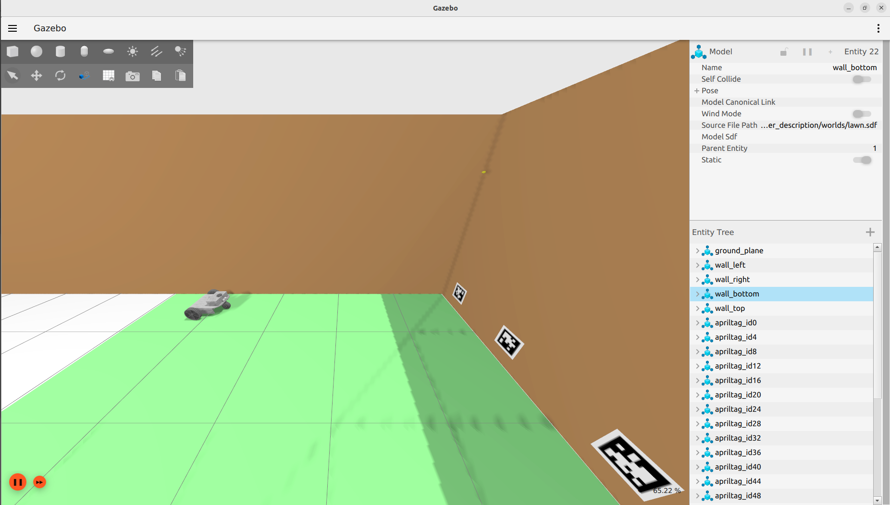
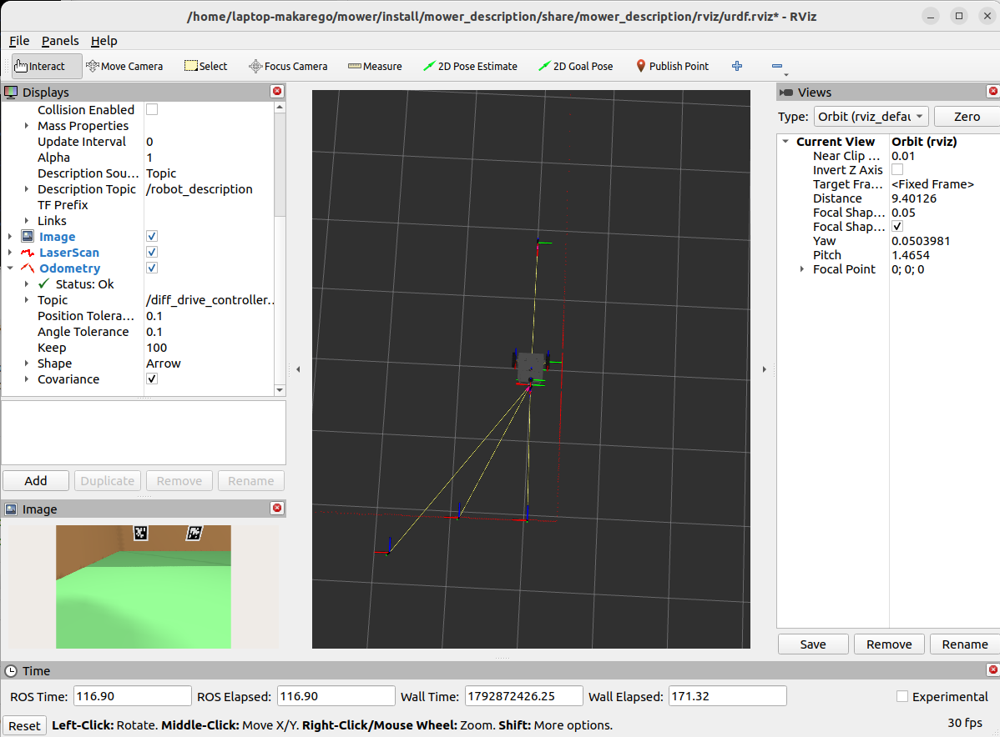

# Autonomous Lawn Mower — ROS 2 simulation

Work-in-progress ROS 2 software for an autonomous lawn mower (UGV) that I am designing and building myself.
The robot model comes from my own CAD design and runs in Gazebo Sim with LiDAR, an RGB camera and an IMU.




## Features

- **Robot model** – URDF/xacro built from my own CAD meshes: differential drive with two driven wheels and a caster,
  RPLIDAR S2 (2D LiDAR), Intel RealSense D435 camera and an IMU with Gaussian noise.

    The RealSense D435 model is reused from an earlier project; the real mower will use a wide-angle Raspberry Pi camera.
  The LiDAR is included for potential features.

- **Simulation** – Gazebo Sim lawn world with AprilTag markers; sensors, clock and joint states bridged to ROS 2 with `ros_gz_bridge`.
- **Drive** – `ros2_control` (`gz_ros2_control`, `JointGroupVelocityController`) plus my own differential-drive node:
  `cmd_vel` → wheel velocities (inverse kinematics), wheel odometry from `joint_states`, `odom → base_link` TF,
  and a safety stop when velocity commands time out.
- **Localization** – `robot_localization` EKF fusing wheel odometry with the IMU gyroscope (2D mode).
- **AprilTag measurements** – `apriltag_ros` detection plus a node that computes range, offset and heading error
  relative to a detected tag and publishes them as a custom `mower_interfaces/TagMeasurement` message.
- **Mowing pattern (experimental)** – state machine for lane-by-lane (boustrophedon) mowing: heading-locked straight
  driving, 90° turns and a lane shift, triggered by an HSV grass-boundary detector (OpenCV).
- **SLAM config** – `slam_toolbox` parameters for mapping with the 2D LiDAR.

## Packages

| Package | Contents |
|---|---|
| `mower_description` | URDF/xacro, meshes, Gazebo world, RViz config, simulation launch |
| `mower_controller` | ros2_control config, drive node, AprilTag feedback, grass detector, mowing state machine |
| `mower_localization` | EKF config and launch, LiDAR safety node (work in progress) |
| `mower_slam` | slam_toolbox parameters |
| `mower_interfaces` | custom messages (`TagMeasurement`) |

## Requirements

- Ubuntu 22.04, ROS 2 Humble, Gazebo Sim  <!-- check your exact versions -->
- `ros_gz`, `gz_ros2_control`, `ros2_controllers`, `robot_localization`, `apriltag_ros`, `slam_toolbox`, `cv_bridge`
- Python: `opencv-python`, `numpy`, `scipy`

## Build

```bash
git clone https://github.com/<login>/<repo>.git ~/mower
cd ~/mower
rosdep install --from-paths src --ignore-src -r -y
colcon build --symlink-install
source install/setup.bash
```

## Run

```bash
# 1. Gazebo + robot + bridges + RViz
ros2 launch mower_description world.launch.py

# 2. Controllers, drive node, AprilTag detection
ros2 launch mower_controller controllers.launch.py

# 3. EKF localization
ros2 launch mower_localization localization.launch.py

# Manual driving
ros2 run teleop_twist_keyboard teleop_twist_keyboard
```

## Status

Early stage, simulation only. The mowing state machine and grass detector are experimental
(disabled in the default launch). Hardware integration is the next step.